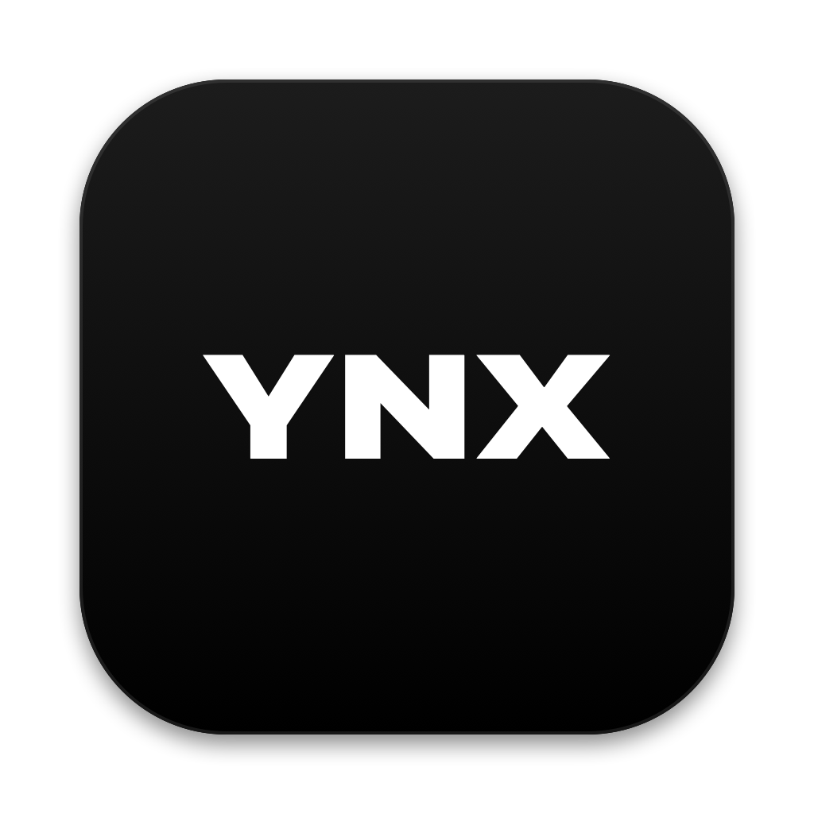
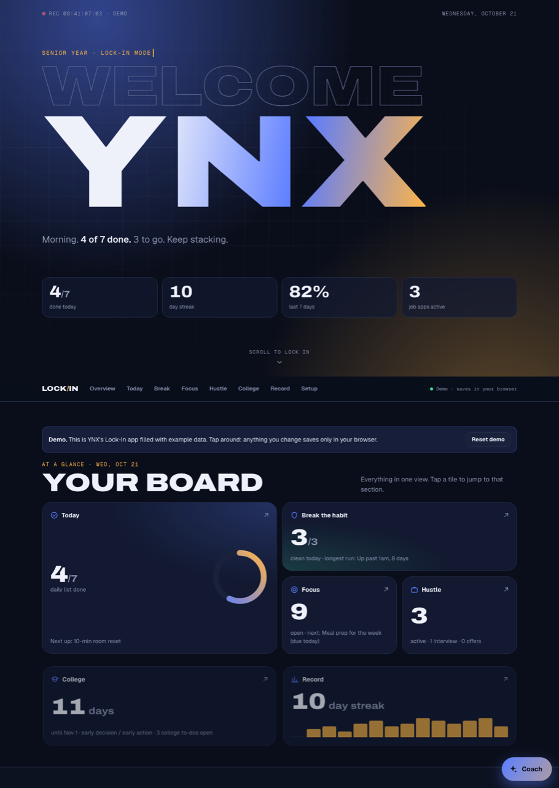

  

<h1 align="center">Lock-In</h1>

  A senior-year command center: daily habits, breaking bad habits, homework, college, and the job hunt, all on one board. 
  <a href="https://ynx-dev-lock-in.static.hf.space/index.html"><b>Live demo →</b></a>

## What it does

| Section | What's in it |
|---|---|
| **Overview** | A bento board with one live tile per section, so the whole day is readable at a glance. |
| **Today** | A daily checklist with a progress ring, a mood rating, and a "one thing I did right" note. Unchecked counts as not done, and past days can be back-filled. |
| **Break the habit** | Days-clean counters, milestone bars (1, 3, 7, 14, 30, 60, 90 days), a 14-day slip strip, and an "urges beaten" count. It can be blurred with one tap for privacy. |
| **Focus** | One-time to-dos sorted by due date and filtered by area (homework, college, money, personal, health), plus quick links to ClassLink, Canvas and Skyward. |
| **Hustle** | A job-application pipeline: Applied → Interview → Offer / No luck. |
| **College** | Countdowns to the usual application deadlines, plus college to-dos. |
| **Record** | A two-week habit grid, a mood line chart, and all-time stats. |
| **Coach** | An AI coach built on Claude that can see the board and act on it: check things off, add to-dos, log urges. |

## How it's built

- **One file.** `index.html` is about 2,000 lines of plain HTML, CSS and JavaScript, with no frameworks or build step.
- **Motion:** a boot-screen intro whose curtains split open, a staggered "WELCOME YNX" title reveal, scroll-driven section reveals using CSS `animation-timeline: view()`, a live REC timecode, and confetti on a full day.
- **Design:** Archivo Expanded for the display type, Geist for body text, and Geist Mono for data. It's dark-first with a matching light theme, and it adjusts for phone screens.
- **Data:** the full app saves to a private database and pulls job, college and Canvas emails from Gmail. This public demo runs on example data, and anything you change saves only in your browser.

## Run it

Open `index.html` in any browser. It has no dependencies and needs no install.

## Privacy

This repo is the **demo build**. It holds example data only. The real app, with real data, Gmail and Coach, stays private.

---

Built by **YNX** with [Claude](https://claude.ai).
